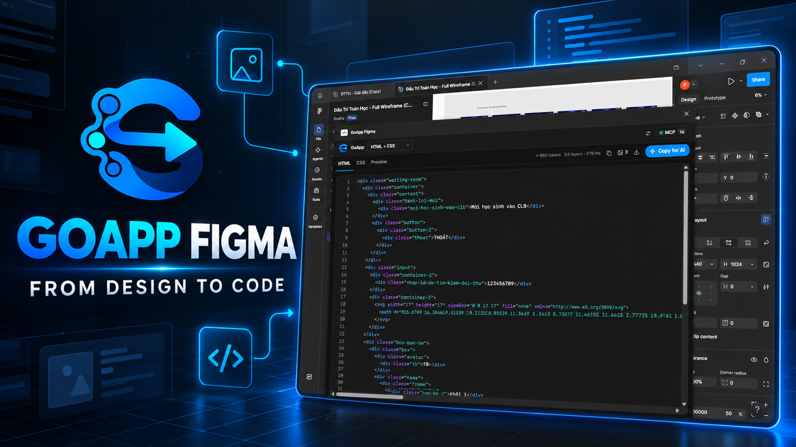
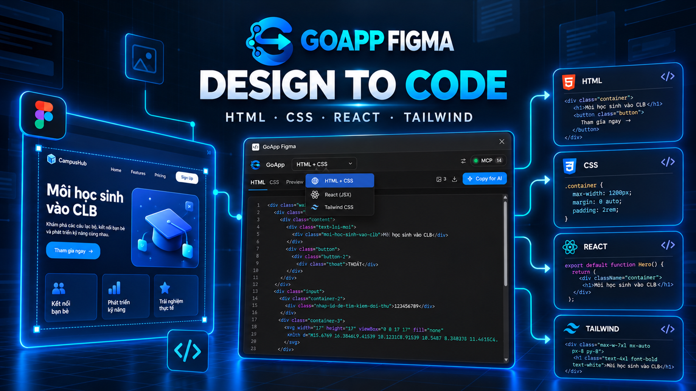
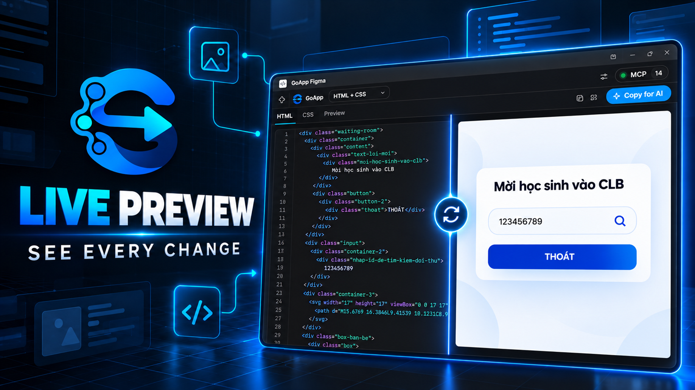
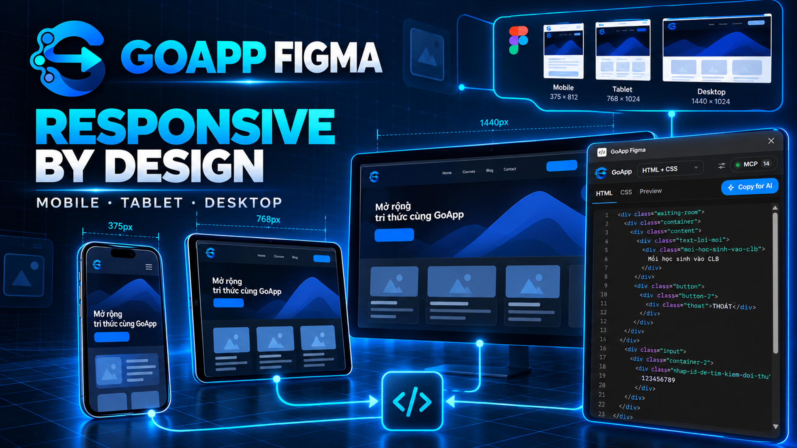
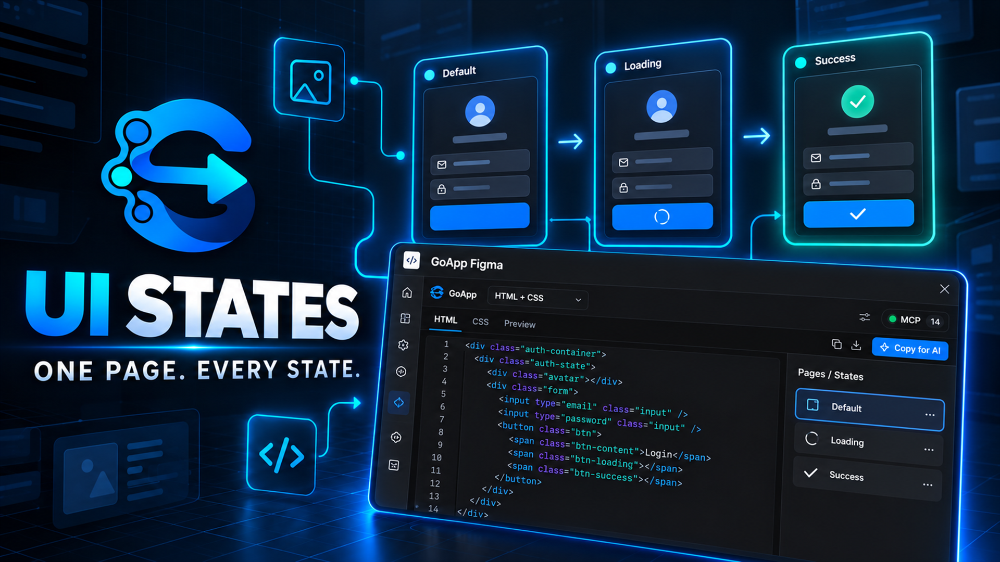
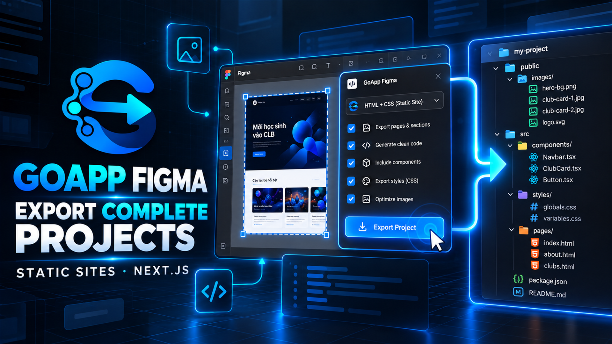
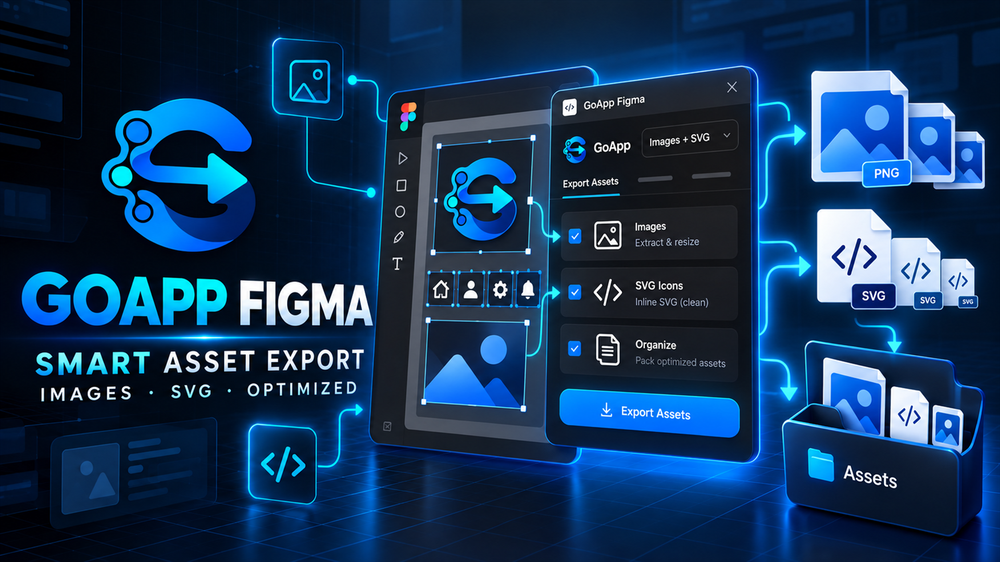
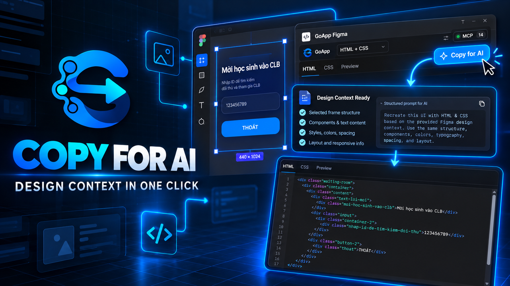
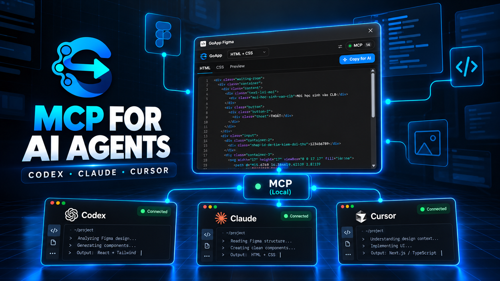
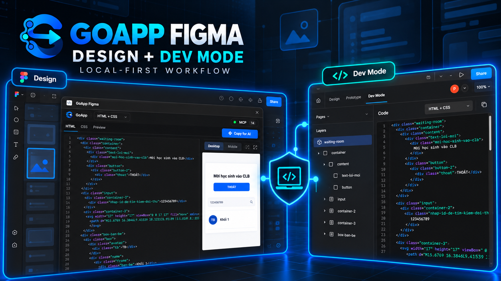

<p align="center">
  
</p>

# GoApp Figma – Desain ke Kode

[English](README.md) · **Bahasa Indonesia** · [Tiếng Việt](README.vi.md)

Plugin Figma yang mengubah layer yang dipilih menjadi kode **HTML + CSS**, **React + Tailwind (v4)**, atau **HTML + Tailwind**, dilengkapi dengan **MCP server** bawaan agar AI Agent seperti Claude Code, Codex, Cursor, dll. dapat membaca desain langsung dari Figma dan menghasilkan kode yang sesuai dengan standar codebase Anda.



- Berjalan di **Design mode** (jendela plugin dengan live preview interaktif) dan **Dev Mode** (panel Code bawaan Figma).
- **Ekspor Proyek Siap Pakai**: ekspor static site atau aplikasi Next.js App Router lengkap beserta seluruh aset gambar.
- **Penggabungan Beberapa Frame Menjadi Satu Halaman**: berdasarkan breakpoint layar (**Responsif**) atau status UI (**States**).
- **Ekspor Single Frame Fluid & Responsif**: otomatis membuat layout responsif full-bleed (`100% width`), pembungkusan fleksibel (`flex-wrap`), dan scrolling horizontal pada tabel tanpa merusak kolom.
- **Inferensi Semantic HTML5**: otomatis mendeteksi tag semantik seperti `<button type="button">`, `<nav>`, `<header>`, `<footer>`, `<aside>`, `<section>`, `<main>`, `<h1>`-`<h4>`, dan `<p>` dari penamaan layer dan tipografi.
- **Dukungan Penuh CSS Grid Auto-Layout**: konversi native dari Figma Grid Auto-Layout ke CSS Grid (`grid-template-columns`, `grid-template-rows`, `gap-x-*`, `gap-y-*`, `col-span-*`, `row-span-*`).
- **MCP untuk AI Agent**: cukup klik **Copy for AI** → tempel ke prompt AI agent Anda → agent akan mengambil konteks desain via MCP dan mengimplementasikan kodenya.
- Aman tanpa panggilan jaringan eksternal: seluruh pemrosesan berjalan di dalam sandbox Figma (hanya memuat Google Fonts untuk preview dan koneksi MCP lokal ke `localhost`).

## Cuplikan Fitur

| | | |
| --- | --- | --- |
|  |  |  |
|  |  |  |
|  |  |  |

## Daftar Isi

- [Instalasi](#instalasi)
- [Penggunaan](#penggunaan)
- [Ekspor Proyek](#ekspor-proyek)
- [Penggabungan Frame ke Satu Halaman](#penggabungan-frame-ke-satu-halaman)
- [Layout Responsif & Fluid Single Frame](#layout-responsif--fluid-single-frame)
- [Inferensi Semantic HTML5](#inferensi-semantic-html5)
- [Dukungan CSS Grid Auto-Layout](#dukungan-css-grid-auto-layout)
- [MCP untuk AI Agent (Claude Code, Cursor, Codex)](#mcp-untuk-ai-agent-claude-code-cursor-codex)
- [Arsitektur Sistem](#arsitektur-sistem)
- [Pengembangan](#pengembangan)
- [Kredit & Atribusi](#kredit--atribusi)
- [Lisensi](#lisensi)

---

## Instalasi

```bash
git clone https://github.com/detriv/go-figma.git
cd go-figma
npm install
npm run build        # atau: npm run dev (watch mode)
```

Di aplikasi Figma Desktop:
1. Masuk ke menu **Plugins → Development → Import plugin from manifest…**
2. Pilih file `manifest.json` di root folder proyek ini.

Hasil kompilasi (`npm run build`) menghasilkan:
- `dist/code.js` (kode sandbox Figma)
- `dist/ui.html` (antarmuka UI plugin)
- `dist/mcp.mjs` (MCP server untuk integrasi AI)

---

## Penggunaan

### Design Mode

Buka plugin dan pilih frame apa pun pada canvas Figma. Kode akan otomatis diperbarui secara live setiap kali seleksi atau elemen berubah:

| Bagian | Fungsi |
| --- | --- |
| Pemilih Stack (kiri atas) | Pilihan output: HTML + CSS / React + Tailwind / HTML + Tailwind |
| ⚙ Code options | Opsi generasi kode: Semantic HTML, Fluid single frame, Optimize images, Color variables, Inline SVG |
| `MCP · n` | Status server MCP dan jumlah agent yang sedang terhubung; klik untuk membuka panel manajemen agent |
| Tab Kode / **Preview** | Melihat kode per file atau melihat live preview interaktif (iframe) |
| `≈ … tokens` | Estimasi token dari kode (mengukur konsumsi context window agent AI) |
| Copy · Images · Export | Salin kode, unduh aset gambar sebagai `.zip`, atau ekspor seluruh proyek |
| **Copy for AI** | Salin prompt praktis agar AI agent mengambil dan menganalisis desain via MCP |

### Dev Mode

Buka panel **Code** di sisi kanan Dev Mode Figma, lalu pilih bahasa output: "HTML + CSS", "React + Tailwind", atau "HTML + Tailwind".

---

## Ekspor Proyek

Tombol **Export** pada tab bar akan mengunduh file `<nama-frame>.zip`. Setiap frame yang dipilih akan menjadi sebuah halaman, dengan frame pertama sebagai halaman utama (`index` / `home`).

| Target | Struktur Proyek yang Dihasilkan |
| --- | --- |
| HTML + CSS | Situs statis: `index.html`, `<frame>.html`, file stylesheet bersama `styles.css`, dan folder `images/` |
| HTML + Tailwind | Situs statis modern berbasis `@tailwindcss/browser@4` (CDN) dan folder `images/` |
| React + Tailwind | Proyek Next.js App Router lengkap: `app/page.jsx`, `app/<frame>/page.jsx`, Tailwind v4, dan `public/images/` |

---

## Penggabungan Frame ke Satu Halaman

Jika Anda memilih beberapa frame sekaligus di Figma, bilah **Pages** menyediakan tiga mode:

1. **Separate**: Setiap frame diekspor sebagai halaman tersendiri (default).
2. **Responsive**: Menggabungkan beberapa frame ukuran berbeda (Mobile, Tablet, Desktop) menjadi **satu halaman responsif**.
3. **States**: Menggabungkan beberapa frame status layar (misal: default, loading, hover, step-2) menjadi **satu halaman dinamis**.

### Mode Responsif (Banyak Breakpoint)
- Frame terkecil (Mobile) menjadi gaya dasar (*mobile-first*).
- Frame yang lebih besar (Tablet, Desktop) hanya menyuntikkan perbedaannya melalui `@media (min-width: 768px | 1024px)` atau prefix Tailwind `md:` / `lg:`.
- Root halaman otomatis menggunakan `width: 100%` dengan `min-height`.
- Tab preview menyediakan tombol peralihan layar per breakpoint.

---

## Layout Responsif & Fluid Single Frame

Jika Anda hanya mendesain dan mengekspor **satu frame saja** (misal hanya layout Desktop), plugin secara otomatis mengaktifkan kecerdasan fluid responsif:
- **Full-Bleed 100%**: Root halaman menyesuaikan lebar layar perangkat (`width: 100%`, `min-height`).
- **Section Melebar Penuh**: Bagian frame utama yang membentang penuh otomatis menjadi `width: 100%` (`w-full`).
- **Pencegahan Overflow**: Kontainer elemen dengan lebar statis diberikan `max-width: 100%` (`max-w-full`) sehingga fleksibel mengecil di layar smartphone tanpa merusak layout.
- **Flex Wrap Cerdas**: Baris elemen fleksibel yang memiliki banyak item otomatis membungkus rapi ke bawah pada layar kecil (`flex-wrap`).
- **Scroll Horizontal Khusus Tabel**: Wadah tabel data otomatis memiliki scroll horizontal (`overflow-x: auto`), sedangkan baris tabel dan kolom di dalamnya tetap utuh tanpa terpotong atau membungkus (*no wrap*).
- **Multi-Viewport Preview**: Live preview menyediakan switcher preset ukuran: **Mobile (375px)**, **Tablet (768px)**, dan **Desktop**.

---

## Inferensi Semantic HTML5

Plugin memiliki modul inferensi semantik pintar yang menerjemahkan nama layer dan hierarki visual menjadi tag standar HTML5:
- **Button / Tombol**: Layer bernama `Button`, `Btn`, `CTA`, `Submit Button`, `Login Btn`, dll. otomatis menjadi `<button type="button">` dan disertai kursor interaktif `cursor: pointer`.
- **Navigasi**: Frame bernama `Navbar`, `Nav`, `Navigation`, `Nav Menu` diterjemahkan menjadi `<nav>`.
- **Header & Footer**: Frame bernama `Header`, `Top Bar` menjadi `<header>`; frame `Footer`, `Bottom Bar` menjadi `<footer>`.
- **Sidebar & Drawer**: Frame bernama `Sidebar`, `Aside`, `Drawer` menjadi `<aside>`.
- **Section**: Frame bernama `Section` atau `Features Section` menjadi `<section>`.
- **Main**: Frame konten utama pada root menjadi `<main>`.
- **Heading & Paragraf**:
  - `<h1>`: Teks bernama `Hero Title`, `Page Title`, atau teks dengan ukuran `font-size ≥ 36px`.
  - `<h2>`: Teks bernama `Section Title`, `Subheading`, atau `font-size ≥ 28px`.
  - `<h3>`: Teks bernama `Card Title`, `Item Title`, atau `font-size ≥ 22px`.
  - `<h4>`: Teks dengan `font-size ≥ 18px` (bold).
  - `<p>`: Teks bernama `Paragraph`, `Description`, `Body`, atau ukuran teks biasa (`≤ 16px`).

*Opsi ini dapat diaktifkan atau dinonaktifkan kapan saja melalui menu **⚙ Code options → Semantic HTML**.*

---

## Dukungan CSS Grid Auto-Layout

Fitur Figma Grid Auto-Layout (`layoutMode === "GRID"`) didukung secara native tanpa posisi absolut:
- **Kontainer Grid**: Dikonversi menjadi `display: grid; grid-template-columns: repeat(N, minmax(0, 1fr));` (CSS) dan `grid grid-cols-N` (Tailwind).
- **Jarak Antar Kolom & Baris**: Menggunakan `row-gap` dan `column-gap` (atau `gap` jika seragam), menghasilkan class Tailwind seperti `gap-4`, `gap-x-4`, `gap-y-6`.
- **Spanning Anak Elemen**: Elemen anak yang merentang beberapa kolom/baris (`gridColumnSpan`, `gridRowSpan`) langsung diterjemahkan menjadi `col-span-N` dan `row-span-N`.
- **Posisi Awal Kolom/Baris**: Mendukung koordinat posisi cell (`col-start-N`, `row-start-N`).

---

## MCP untuk AI Agent (Claude Code, Cursor, Codex)

Plugin ini terintegrasi langsung dengan Model Context Protocol (MCP):
1. Jalankan MCP server lokal:
   ```bash
   npm run mcp
   ```
2. Hubungkan Claude Code, Cursor, atau Codex ke server MCP GoApp Figma.
3. Di Figma, pilih frame lalu klik tombol **Copy for AI**.
4. Tempelkan prompt ke chat AI agent Anda. Agent akan memanggil MCP tools seperti `get_metadata`, `get_design_context`, dan `get_screenshot` untuk membangun fitur secara presisi sesuai desain Figma Anda.

---

## Arsitektur Sistem

Pipeline pemrosesan data:
```
Figma SceneNode ──► normalize.ts ──► Intermediate Representation (IR)
                                               │
                                 ┌─────────────┴─────────────┐
                                 ▼                           ▼
                           css.ts / tree.ts          responsive.ts (Fluid/Merge)
                                 │                           │
                                 └─────────────┬─────────────┘
                                               ▼
                         tailwind.ts / htmlCss.ts / project.ts
```

- `src/core/normalize.ts`: Satu-satunya modul yang berinteraksi dengan API Figma.
- `src/core/ir.ts`: Definisi tipe data IR murni tanpa dependensi Figma.
- `src/generators/semantic.ts`: Mesin inferensi semantik HTML5.
- `src/generators/css.ts`: Pemetaan IR ke deklarasi CSS (Flexbox, CSS Grid, border, bayangan, gradien).
- `src/generators/tailwind.ts`: Kompilator deklarasi CSS ke class Tailwind v4.
- `src/generators/responsive.ts`: Mesin fluid responsif single frame dan penggabungan breakpoint.
- `src/ui/`: Antarmuka plugin berbasis React 19.

---

## Pengembangan

```bash
# Menjalankan build dan pengawasan perubahan file (watch mode)
npm run dev

# Menjalankan rangkaian unit test (Vitest)
npm test

# Menjalankan pemeriksaan tipe TypeScript
npm run typecheck
```

---

## Kredit & Atribusi

Proyek ini dikembangkan berdasarkan dan memperluas repositori open-source [go-figma](https://github.com/tuyndev18/go-figma) karya **tuyndev18** ([@tuyndev18](https://github.com/tuyndev18)). Kami mengucapkan apresiasi dan terima kasih yang sebesar-besarnya kepada penulis asli atas fondasi luar biasa yang telah dibangun.

---

## Lisensi

Didistribusikan di bawah lisensi [MIT](LICENSE).

